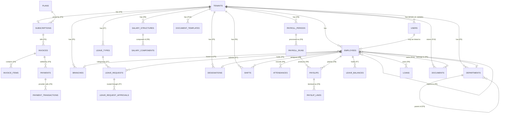

# Database

> Living document. Tables marked _(planned Pn)_ are designed but not yet
> migrated. Phase 1 tables are live.

## Conventions

- Primary key `id` (`bigint`, auto-increment). External identifier `uuid`
  (ordered UUID) on tenant, user, employee and every other externally exposed
  entity.
- Every **tenant-owned** table has `tenant_id` → `tenants.id`,
  `on delete cascade`.
- Composite indexes lead with `tenant_id`.
- `deleted_at` (soft delete) on people/records that must be recoverable.
- Timestamps everywhere.
- Enums stored as short strings, backed by PHP enums in `App\Enums`.

## Phase 1 tables (live)

### `tenants`
The organization/subscriber. **Not** tenant-owned (it is the tenant).

| Column | Type | Notes |
|--------|------|-------|
| id | bigint pk | |
| uuid | uuid unique | external id, API/URL |
| slug | string unique | subdomain + route-model binding |
| name | string | trading name |
| legal_name | string null | |
| registration_number | string null | company registration |
| tax_number | string null | KRA PIN etc. |
| email | string | primary contact |
| phone | string null | |
| website | string null | |
| logo_path | string null | private disk key |
| address_line1 / address_line2 | string null | |
| city / state / postal_code | string null | |
| country | char(2) null | ISO-3166 alpha-2 |
| currency | char(3) | ISO-4217, default `KES` |
| timezone | string | IANA, default `Africa/Nairobi` |
| fiscal_year_start | tinyint unsigned | month 1–12, default 1 |
| custom_domain | string null unique | exact-host resolution |
| status | string | `App\Enums\TenantStatus` |
| trial_ends_at | timestamp null | |
| settings | json null | branding/config bag (typed accessors later) |
| timestamps, deleted_at | | |

Indexes: `status`, `slug` (unique), `uuid` (unique), `custom_domain` (unique).

Subscription/plan foreign keys are added in **P3**; `status` + `trial_ends_at`
carry trial state until then.

### `users` (extended)
Login accounts — platform staff **and** tenant users. Globally unique email.

Added columns: `uuid` (uuid, unique), `tenant_id` (→ `tenants.id`,
`nullOnDelete`, nullable — null = platform staff), `is_platform_admin`
(boolean, default false).
Index: `(tenant_id, is_platform_admin)`.

### `employees` (Phase 1 slice — expanded in P4)
Tenant-owned HR record for a person. Distinct from `users`: an employee may have
no login, and a `user` may be linked via `user_id`.

| Column | Type | Notes |
|--------|------|-------|
| id | bigint pk | |
| tenant_id | bigint fk → tenants | cascade |
| uuid | uuid unique | |
| user_id | bigint fk → users null | optional login link, nullOnDelete |
| employee_number | string | unique per tenant |
| first_name / middle_name / last_name | string / null / string | |
| email | string null | unique per tenant |
| phone | string null | |
| job_title | string null | free text until P20 designations |
| hire_date | date null | |
| status | string | `App\Enums\EmploymentStatus` |
| timestamps, deleted_at | | |

Indexes: unique `(tenant_id, employee_number)`, unique `(tenant_id, email)`,
`(tenant_id, status)`, `uuid` unique.

## Planned tables by phase (summary)

- **P2** `roles`, `permissions`, `model_has_roles`, `role_has_permissions`,
  `model_has_permissions` (Spatie, `team_id = tenant_id`), `invitations`,
  `login_activities`.
- **P3** `plans`, `subscriptions`, `subscription_items`, `invoices`,
  `invoice_items`, `payments`, `payment_transactions`, `payment_methods`,
  `tax_rules` (effective-dated).
- **P4** `employees` full column set + `employee_bank_accounts`,
  `employee_emergency_contacts`, `employee_statutory_details`,
  `employment_histories`.
- **P5** `branches`, `departments` (self-referencing `parent_id`),
  `designations`, `department_user` (heads).
- **P6** `shifts`, `employee_shift`, `work_schedules`, `attendances`,
  `attendance_devices`, `attendance_logs`.
- **P7** `leave_types`, `leave_policies`, `leave_entitlements`,
  `leave_requests`, `leave_request_approvals`, `leave_balances`, `holidays`,
  `holiday_calendars`.
- **P8** `salary_structures`, `salary_components`,
  `employee_salary_components`, `payroll_periods`, `payroll_runs`,
  `payslips`, `payslip_lines`, `loans`, `loan_repayments`.
- **P10** `documents`, `document_types`, `document_templates`,
  `generated_documents`.
- **P11** `performance_cycles`, `goals`, `goal_check_ins`, `kpis`,
  `performance_reviews`, `review_ratings`.
- **P12** `job_positions`, `vacancies`, `applicants`, `applications`,
  `application_activities`, `interviews`, `offers`.
- **P13** `expenses`, `expense_items`, `expense_approvals`, `assets`,
  `asset_assignments`. (Loans/loan_repayments from P8 gain a UI + schedule
  endpoint + self-service request.)
- **P15** `notifications` (Laravel), `announcements`, `announcement_reads`,
  `tenant_branding`, `notification_preferences`. (`announcements` +
  `is_pinned`/`acknowledgement_required`; `announcement_reads` +
  `acknowledged_at`.)
- **P16** `personal_access_tokens` (Sanctum), `webhook_endpoints`,
  `webhook_deliveries`.
- **P17** `audit_logs` (append-only), `activity_log`.

## ERD (core — Phase 1 solid, planned dashed)

